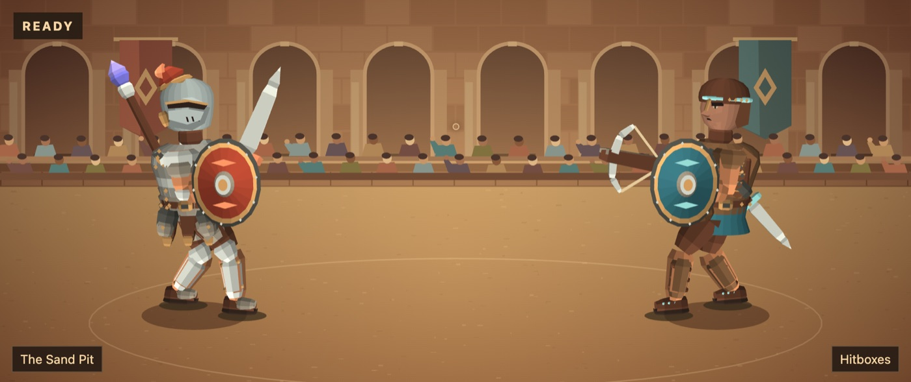
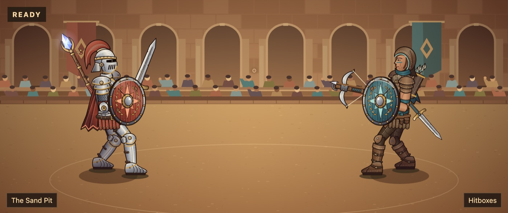
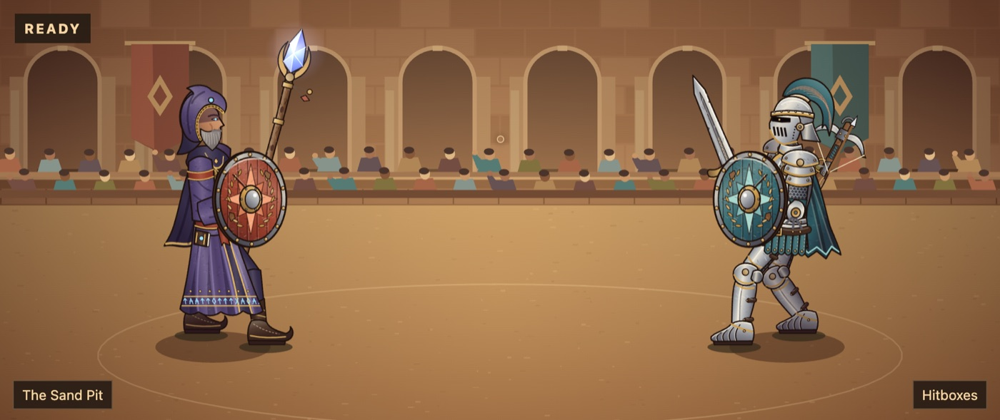

# Detailed 2D art: investigation, proof of concept and plan

Branch: `claude/detailed-2d-assets-poc-63e424`, cut from `main` at `aa10e25`. Measured 2026-11-26.

## Answer

Detailed 2D fighters look far better than the current meshes and draw faster, as long as each part is painted once into a sprite and only moved afterwards. The proof of concept is playable behind the **Art 3D / Art 2D** button.

**3D (today)**

**2D proof of concept, same frame**

## Try it

- `open "index.html?style=2d&cast=1"`: plate with sword and staff against leather with crossbow and sword.
- `open "index.html?style=2d&cast=2"`: robes with staff against plate with sword and crossbow.
- The **Art** button switches painters at any time, also mid-bout, and remembers the choice. 3D stays the default.

## What is in the proof of concept

One asset per class, all in `fighter2d.js`:

| Class | Asset |
| --- | --- |
| Melee armor | Plate harness: crested helmet, engraved breastplate, mail, pauldrons, greaves, cape |
| Ranged armor | Hunter's leathers: hooded face, fur mantle, studded jerkin, bracers, boots, quiver |
| Magic armor | Battle robes: bearded mage, deep hood, embroidered mantle and runed skirt |
| Melee weapon | Sword |
| Ranged weapon | Crossbow, with a live string and loaded bolt |
| Magic weapon | Staff with a glowing crystal |
| Shield | Round shield, with stuck bolts |

Everything else still works in 2D mode:

- The other 24 weapons, the buckler, the tower shield and all specials keep their 3D meshes, painted in place between the sprites.
- The other nine armor kits use their class's 2D set, so they look alike for now.

Nothing in the simulation changed. Sprites hang on the same joints as before, so timing, hit detection and **Hitboxes** are unaffected.

## How it works

1. Each body part and item is vector art written in code (paths, gradients, mail rings, rivets, stitching, wear).
2. At the size it appears on screen it is painted once into its own offscreen canvas: 37 sprites for the first matchup.
3. Each frame moves, rotates and stretches those sprites along the skeleton with `drawImage`, about 20 calls per fighter in place of about 1,100–1,400 projected, sorted and filled faces.

So detail costs bake time, not frame time. Far-side limbs get a shaded copy for depth, and the frost finisher uses a lazily made ice-tinted copy.

No image files, build step or dependency were added.

## Performance

Headless Chrome on an Apple M1. Plate against leather, ready pose.

| Measure | 3D, Quality Low | 2D |
| --- | ---: | ---: |
| Main-thread time per `draw()`, desktop 1900×800 | 3.7 ms | 0.26 ms |
| Main-thread time per `draw()`, phone size 706×620 | 4.1 ms | 0.22 ms |
| Frame time with 20 full redraws per frame, desktop | 95 ms | 16.7 ms (still 60 FPS) |
| Frame time with 60 full redraws per frame, desktop | 375 ms | 26 ms |
| Per draw with the GPU turned off, desktop | 10.9 ms | 6.6 ms |
| Per draw with the GPU turned off, phone size | 8.3 ms | 4.2 ms |

- The repeated redraws are a stress test that includes graphics-chip work, which main-thread timing misses.
- 3D at Quality High costs about twice Low on the main thread, and 2D already shows far more detail than High.
- Sprite memory for the first matchup: about 2.6 MB on desktop and 0.5 MB at phone size. Baking took 7–60 ms, once, and repeats after a resize or a new look.
- A forced-readback timing in the app's hidden browser pane showed 2D as slower. Neither real frame measurement above reproduced that, so it is not counted.
- **Not measured on a real phone.** Open `?style=2d&cast=1&bench` and compare with `?style=3d&cast=1&bench`. The first phone test of the 3D game reported about 24 FPS, and its cause was never confirmed.

## Options considered

| Approach | Look | Frame cost | Art cost | Verdict |
| --- | --- | --- | --- | --- |
| Draw vector paths live every frame | Good, but detail is rationed | Grows with detail | Medium | Rejected: this was the idea in the `2d-art` branch plan |
| Frame-by-frame sprite sheets | Best possible animation | Very low | Huge: every armor × weapon × motion | Rejected |
| **Cut-out parts baked from code vectors** | Very good, crisp at any size | Very low | Medium, per part | **Used here** |
| Cut-out parts from painted PNGs | Highest ceiling | Same as above | Needs an artist or image generator, plus team-color masks | Possible later: only the bake step changes |
| Skeletal animation tool (Spine and similar) | Very good | Low | License, runtime dependency, rig work | Rejected for a no-build game |

## What still looks or behaves roughly

- Parts are rigid: elbows, knees and the waist show seams in extreme poses.
- One side-on drawing per part, so there is no true twist or turn of the torso or shield.
- Sprites do not interleave by depth between the two fighters. The attacker is drawn on top.
- The backdrop and crowd are still flat, softer art, so the fighters stand out more than the scenery.
- Mixed fighters (a 3D spear on a 2D body) look inconsistent until every item has art.
- The Polys and WebGL benchmark toggles do nothing to the sprites.

## Plan to finish

Each step is a playable commit. Token estimates are rough and cover drawing, browser checks and the commit.

| # | Step | Est. tokens | Done when |
| --- | --- | ---: | --- |
| 1 | Look at the proof of concept, test on the phone, and decide | — | 2D or 3D is chosen |
| 2 | Joint polish: overlap pieces at knee, elbow and waist; a swing pose for the cape and skirt | 40k | No visible gaps in a full bout |
| 3 | Remaining six weapon families: spear, axe, mace, flail, greatsword, maul | 90k | Every family draws in 2D |
| 4 | Eighteen weapon variants and the buckler and tower shield | 100k | No variant falls back to 3D |
| 5 | Nine remaining armor kits as variations of the three sets (colors, helmet, one signature piece) | 110k | All twelve kits read apart at game zoom |
| 6 | Fifteen specials: palette plus one detail each | 70k | No fighter uses a mesh |
| 7 | Matching backdrop and crowd art for the three venues | 80k | Arena and fighters share one style |
| 8 | Make 2D the default, remove the 3D painter, WebGL path and Quality setting, update docs | 40k | One renderer remains |

Steps 2–8 come to about 530k tokens. Steps 2–4 (about 230k) remove the mixed look on weapons and shields.

If 2D is chosen, stop adding 3D mesh detail, because step 8 deletes it.
