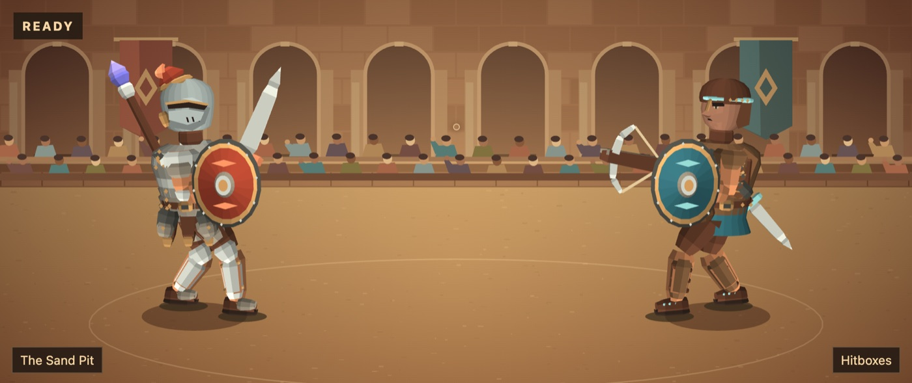
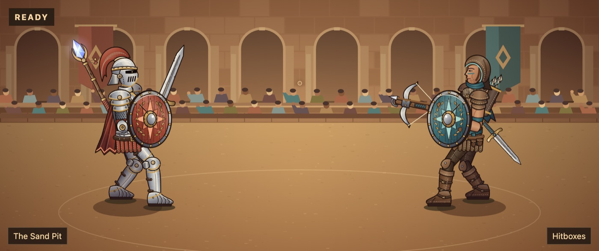
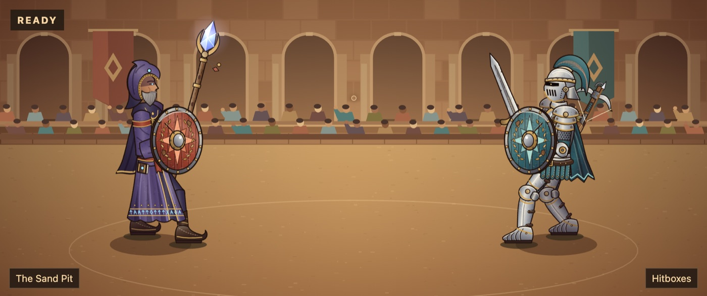
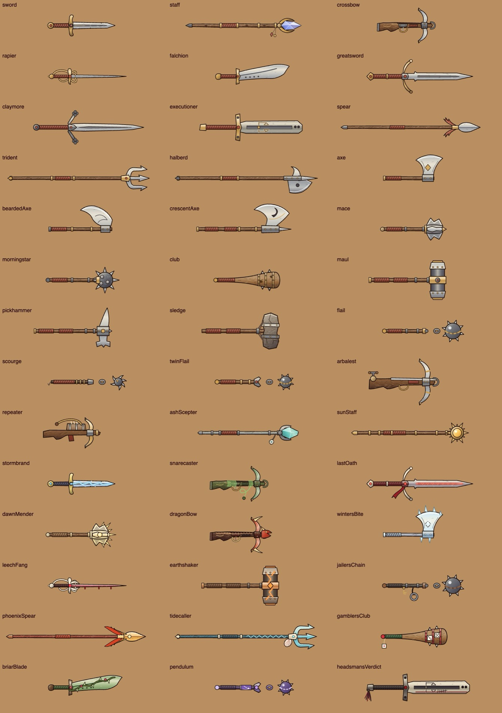
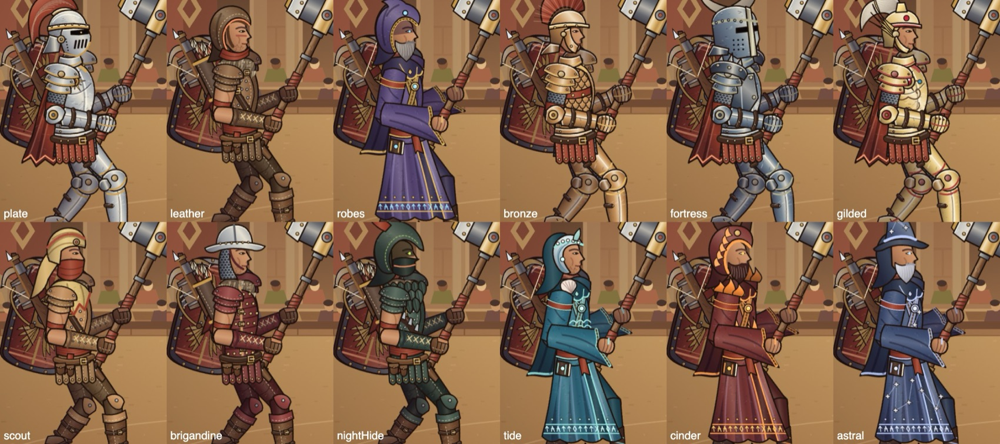
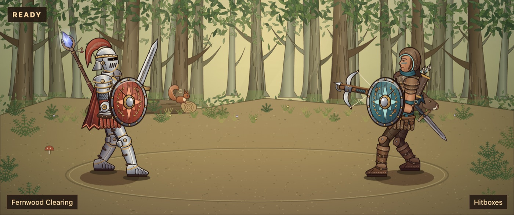
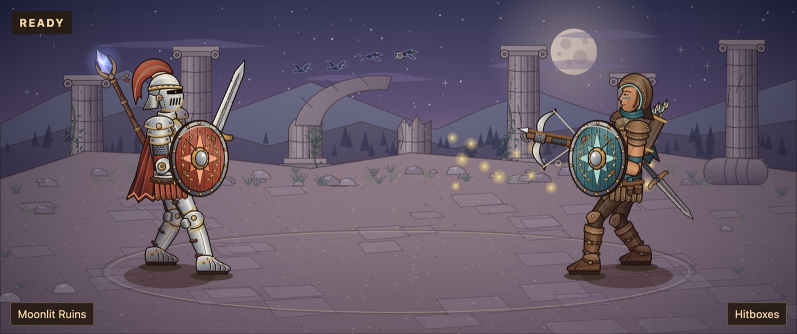

# 2D art: how it works, and why it replaced the 3D renderer

Measured 2026-11-26 on branch `claude/detailed-2d-assets-poc-63e424`, cut from `main` at `aa10e25`. The 3D renderer, its WebGL painter and the Quality setting were removed on 2026-11-27, after the 2D art was checked on a phone; they remain in git history up to that removal. The 3D numbers below are the last measured before it.

## Answer

Detailed 2D fighters look far better than the low-poly meshes did and draw faster, as long as each part is painted once into a sprite and only moved afterwards.

**Before: 3D**

**After: 2D, same frame**

## What has 2D art

Everything a fighter can carry or wear:

| Group | Count | File |
| --- | ---: | --- |
| First set: plate, leather, robes, sword, crossbow, staff, round shield | 7 | `fighter2d.js` |
| Other weapons | 24 | `weapons2d.js` |
| Special weapons, each its base shape in its own materials plus details | 15 | `weapons2d.js` |
| Buckler and tower shield | 2 | `weapons2d.js` |
| Other armor kits, each its class's set with its own materials, headgear and signature piece | 9 | `armor2d.js` |

Each blade and head covers the stretch that `weaponSegments()` hit-tests, and flail chains hang on the same curves as the hit test. Nothing in the simulation changed, so timing, hit detection and **Hitboxes** are unaffected. A sweep of 66 bouts (every finisher and 60 random matchups) found no item without art.

### Venues

`venues2d.js` redraws the Sand Pit, Fernwood Clearing and Moonlit Ruins. The still art is painted into the cached backdrop, so it adds nothing per frame, and the crowd and wildlife are sprites on the same paths as before, so their click targets still work.

With 20 full redraws per frame on the desktop size, 2D held about 17 ms in all three venues, against 88–97 ms for 3D.

### Adding an item

Add an entry to `ArenaArt2D.weapons`, `.shields` or `.armors` under the item's key. Until it exists, a weapon borrows its family's shape, a shield the round shield and an armor kit its class's set.

## How it works

1. Each body part and item is vector art written in code (paths, gradients, mail rings, rivets, stitching, wear).
2. At the size it appears on screen it is painted once into its own offscreen canvas: 53 sprites for the first matchup.
3. Each frame moves, rotates and stretches those sprites along the skeleton with `drawImage`, about 30 calls per fighter in place of about 1,100–1,400 projected, sorted and filled faces.

Fillers sit under each knee, elbow and the waist, and the knee and elbow guards turn halfway between the two limb parts. Capes and robe hems trail the body on a damped spring.

So detail costs bake time, not frame time. Far-side limbs and stowed gear get a shaded copy for depth, and the frost finisher uses a lazily made ice-tinted copy.

No image files, build step or dependency were added.

## Performance

Headless Chrome on an Apple M1. Plate against leather, ready pose.

| Measure | 3D, Quality Low | 2D |
| --- | ---: | ---: |
| Main-thread time per `draw()`, desktop 1900×800 | 3.9 ms | 0.33 ms |
| Main-thread time per `draw()`, phone size 706×620 | 4.0 ms | 0.24 ms |
| Frame time with 20 full redraws per frame, desktop | 89 ms | 16.7 ms (still 60 FPS) |
| Frame time with 60 full redraws per frame, desktop | 344 ms | 27 ms |
| Per draw with the GPU turned off, desktop | 12.1 ms | 8.3 ms |
| Per draw with the GPU turned off, phone size | 9.5 ms | 4.2 ms |

- The repeated redraws are a stress test that includes graphics-chip work, which main-thread timing misses.
- 3D at Quality High costs about twice Low on the main thread, and 2D already shows far more detail than High.
- Sprite memory for the first matchup: about 2.8 MB on desktop and 0.5 MB at phone size. Baking took 7–60 ms, once, and repeats after a resize or a new look.
- Looks pile up over many matchups, so sprites are released between bouts once they pass 12 MB. Peak in the 66-bout sweep was about 15 MB on desktop.
- A forced-readback timing in the app's hidden browser pane showed 2D as slower. Neither real frame measurement above reproduced that, so it is not counted.
- **Phone:** reported to work fine on 2026-11-27, without frame-rate numbers. Open the game with `?bench` to get them. The first phone test of the 3D game reported about 24 FPS, and its cause was never confirmed.

## Options considered

| Approach | Look | Frame cost | Art cost | Verdict |
| --- | --- | --- | --- | --- |
| Draw vector paths live every frame | Good, but detail is rationed | Grows with detail | Medium | Rejected: this was the idea in the `2d-art` branch plan |
| Frame-by-frame sprite sheets | Best possible animation | Very low | Huge: every armor × weapon × motion | Rejected |
| **Cut-out parts baked from code vectors** | Very good, crisp at any size | Very low | Medium, per part | **Used here** |
| Cut-out parts from painted PNGs | Highest ceiling | Same as above | Needs an artist or image generator, plus team-color masks | Possible later: only the bake step changes |
| Skeletal animation tool (Spine and similar) | Very good | Low | License, runtime dependency, rig work | Rejected for a no-build game |

## What still looks or behaves roughly

- Parts are rigid: a fully folded limb or a fallen body can still overlap awkwardly, and the tunic strips do not swing.
- One side-on drawing per part, so there is no true twist or turn of the torso or shield.
- Specials do not change their art with their state (Last Oath's blade does not brighten when sworn; the aura still shows it).
- Sprites do not interleave by depth between the two fighters. The attacker is drawn on top.

## State

Joint polish, every weapon, shield, special, armor kit and venue, the switch to 2D as the default and the removal of the 3D renderer are done. A seeded run of 60 fights gave identical results before and after the removal.
